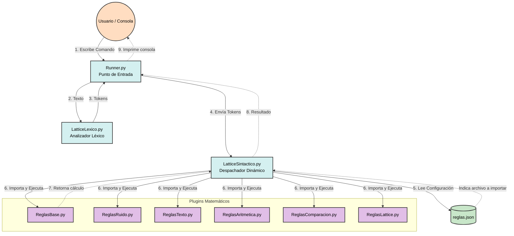
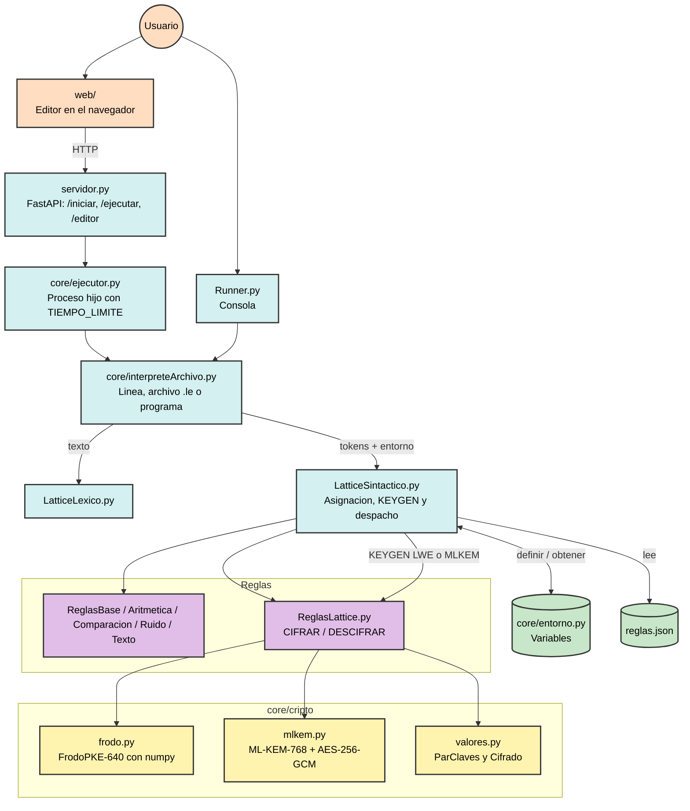
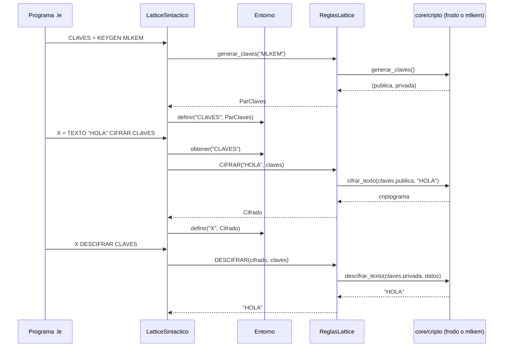

# Arquitectura del Intérprete Lattice Encrypt

Este diagrama describe la arquitectura general del proyecto, mostrando cómo se conectan los módulos principales y el despachador dinámico. Utilizando como ejemplo la operación `VECTOR(1,2) SUMA VECTOR(3,4)`.

## Vista completa: consola, servidor web, variables y cifrado

Ademas de la consola, el interprete se usa desde un servidor web (FastAPI) que sirve el editor y ejecuta cada programa en un proceso aparte con limite de tiempo. El analizador sintactico guarda las variables en un `Entorno` (tabla de simbolos), y `ReglasLattice.py` delega el cifrado en `core/cripto/`.

## Secuencia del cifrado

Al imprimir o devolver por la API, `ParClaves` y `Cifrado` solo muestran un resumen (`<CLAVES ML-KEM-768>`); el material de clave nunca sale del interprete.
